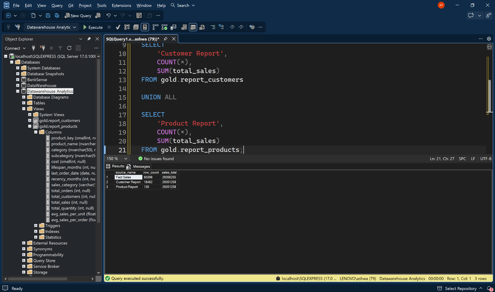

# SQL Advanced Analytics

A Microsoft SQL Server portfolio project that applies analytical SQL to a dimensional sales model. It progresses from data exploration to time-series analysis, ranking, cumulative metrics, segmentation, and reusable customer and product reporting views.

The emphasis is on **business meaning, correct aggregation grain, explicit metric definitions, and validation**—not simply demonstrating SQL syntax.

## Project at a glance

| Area | Details |
|---|---|
| Database platform | Microsoft SQL Server |
| Language | T-SQL |
| Source database | `Datawarehouse Analytics` |
| Source objects | `gold.fact_sales`, `gold.dim_customers`, `gold.dim_products` |
| Analytical scope | 12 topics across 13 SQL scripts |
| Reporting outputs | `gold.report_customers`, `gold.report_products` |
| Downstream use | SQL analysis and Power BI reporting |

**Related data foundation:** [SQL Data Warehouse Project](https://github.com/Ashwannii-20/SQL-Data-Warehouse-Project)

## Business problem

Sales data is stored at transaction-line level, while business users often need customer-, product-, category-, and time-based measures. The project develops a repeatable SQL workflow to answer questions such as:

- Which products and categories contribute the most revenue?
- How do sales, units, orders, and active customers change over time?
- Which products perform above or below their historical average?
- What share of revenue comes from each product category?
- How can products be grouped by cost and customers by purchasing behaviour?
- Which measures should be exposed in reusable customer and product reports?

## Analytical workflow

### 1. Exploratory data analysis

| # | Topic | Script |
|---:|---|---|
| 01 | Database exploration | [01_database_exploration.sql](scripts/01_exploratory_data_analysis/01_database_exploration.sql) |
| 02 | Dimensions exploration | [02_dimensions_exploration.sql](scripts/01_exploratory_data_analysis/02_dimensions_exploration.sql) |
| 03 | Date range exploration | [03_date_range_exploration.sql](scripts/01_exploratory_data_analysis/03_date_range_exploration.sql) |
| 04 | Measures exploration | [04_measures_exploration.sql](scripts/01_exploratory_data_analysis/04_measures_exploration.sql) |
| 05 | Magnitude analysis | [05_magnitude_analysis.sql](scripts/01_exploratory_data_analysis/05_magnitude_analysis.sql) |
| 06 | Ranking analysis | [06_ranking_analysis.sql](scripts/01_exploratory_data_analysis/06_ranking_analysis.sql) |

### 2. Advanced analytics

| # | Topic | Script |
|---:|---|---|
| 07 | Change-over-time analysis | [07_change_over_time_analysis.sql](scripts/02_advanced_analytics/07_change_over_time_analysis.sql) |
| 08 | Cumulative analysis | [08_cumulative_analysis.sql](scripts/02_advanced_analytics/08_cumulative_analysis.sql) |
| 09 | Performance analysis | [09_performance_analysis.sql](scripts/02_advanced_analytics/09_performance_analysis.sql) |
| 10 | Part-to-whole analysis | [10_part_to_whole_analysis.sql](scripts/02_advanced_analytics/10_part_to_whole_analysis.sql) |
| 11 | Data segmentation | [11_data_segmentation.sql](scripts/02_advanced_analytics/11_data_segmentation.sql) |

### 3. Reporting

The Reporting topic produces two separate views:

| Script | View | Output grain |
|---|---|---|
| [12_report_customers.sql](scripts/03_reporting/12_report_customers.sql) | `gold.report_customers` | One row per customer with qualifying dated sales |
| [13_report_products.sql](scripts/03_reporting/13_report_products.sql) | `gold.report_products` | One row per product with qualifying dated sales |

## Data model and grain

The project consumes the Gold Layer from the related data warehouse repository.

| Object | Role | Key fields |
|---|---|---|
| `gold.fact_sales` | Sales fact view | ORDER_NUMBER, PRODUCT_KEY, CUSTOMER_KEY, ORDER_DATE, SALES_AMOUNT, QUANTITY |
| `gold.dim_customers` | Customer dimension | CUSTOMER_KEY, CUSTOMER_ID, customer attributes |
| `gold.dim_products` | Product dimension | PRODUCT_KEY, PRODUCT_ID, product hierarchy and cost |

The sales fact is at **order-line grain**: one row represents a product line within an order. An order can therefore appear on multiple rows. The analysis uses distinct order numbers when the required measure is the number of orders.

The upstream fact view uses left joins to the dimensions. A fact row can therefore have a missing dimension key when no matching dimension record exists. The reporting views use inner joins and include only fact rows with a matching dimension record and a non-null order date. The validation workflow makes this scope visible rather than silently treating unmatched rows as included.

The product dimension in the upstream warehouse contains current products. Historical sales for products not represented in that current-product dimension may not have a matching product key.

See [the architecture guide](docs/architecture.md) for the workflow and relationship diagrams.

## SQL methods demonstrated

- Schema and dimensional exploration
- Joins, filters, aggregates, and grouped analysis
- Common Table Expressions (CTEs)
- Ranking with `ROW_NUMBER()` and `RANK()`
- Window aggregates with `SUM() OVER()` and `AVG() OVER()`
- Period comparisons with `LAG()`
- Date grouping and calculations with `DATEFROMPARTS()`, `YEAR()`, `MONTH()`, and `DATEDIFF()`
- Conditional business rules using `CASE`
- Reusable reporting logic using `CREATE OR ALTER VIEW`

## Selected analytical design decisions

- **Order counting:** distinct order numbers are used because the fact is at order-line grain.
- **Cumulative metrics:** the all-time running total is ordered by month; the separate year-to-date example resets by year.
- **Period comparisons:** `LAG()` is described as comparing with the previous available period. Missing calendar years are not assumed to be zero.
- **Calendar-month span:** the inclusive span between first and last order months is distinguished from the count of months in which purchases actually occurred.
- **Weighted unit sales:** product-level sales per unit is calculated as total sales divided by total quantity.
- **Business classifications:** customer and product thresholds are explicit portfolio assumptions, not universal business policies.
- **Unmatched dimensions:** missing customer/product mappings are surfaced as a validation concern.

Metric formulas and assumptions are recorded in [Business Rules and Validation](docs/business-rules-and-validation.md).

## Quality assurance and status

The repository includes a validation script for reporting grain, dimension-key uniqueness, unmatched fact keys, source-to-report reconciliation, and entity-level metric comparisons.

**Execution evidence captured (14 November 2026):** selected validation queries were run in SSMS and returned successful results. The observed fact population contained 60,398 rows, sales of 29,356,250, quantity of 60,423, and 27,659 distinct orders. The customer and product reports each returned sales of 29,351,258. Nineteen fact rows had a NULL order date and contributed 4,992 in sales; both reporting view definitions contain the `order_date IS NOT NULL` filter. The resulting mapped dated-sales total therefore reconciles exactly: 29,356,250 - 4,992 = 29,351,258.

**Screenshots:** the original SSMS screenshots are in [docs/images/evidence](docs/images/evidence/) and shown in [Execution Evidence](docs/validation-evidence.md#8-screenshots).

| # | Check | Screenshot |
|---:|---|---|
| 01 | Fact-table baseline: 60,398 rows, 29,356,250 sales, 60,423 units, 27,659 orders | [view](docs/images/evidence/01-fact-table-baseline.png) |
| 02 | Fact rows with no matching customer key: 0 | [view](docs/images/evidence/02-unmatched-customer-keys.png) |
| 03 | Duplicate product keys in the product dimension: no rows | [view](docs/images/evidence/03-duplicate-product-keys.png) |
| 04 | Fact rows with no matching product key: 0 | [view](docs/images/evidence/04-unmatched-product-keys.png) |
| 05 | Product report view preview | [view](docs/images/evidence/05-product-report-preview.png) |
| 06 | Customer report view preview | [view](docs/images/evidence/06-customer-report-preview.png) |
| 07 | Fact vs customer report vs product report totals | [view](docs/images/evidence/07-sales-reconciliation.png) |
| 08 | 19 rows with a NULL order date, carrying 4,992 in sales | [view](docs/images/evidence/08-null-order-date-sales.png) |
| 09 | `order_date IS NOT NULL` found in both view definitions | [view](docs/images/evidence/09-date-filter-confirmation.png) |

The screenshots also show zero unmatched customer keys, zero unmatched product keys, and no duplicate product keys in the tested queries. These are **selected manual checks**, not proof that every statement in `tests/validate_reporting_views.sql` has been executed. Customer-key duplicate checks, reporting-key grain checks, and the full entity-level `EXCEPT` comparisons still need explicit recorded results before the complete validation suite can be marked passed.

The committed SQL files are curated portfolio versions of the analytical work. Compare them with any local working copies before treating this repository as the canonical execution copy.

## Setup and execution

1. Build or restore the upstream [SQL Data Warehouse Project](https://github.com/Ashwannii-20/SQL-Data-Warehouse-Project).
2. Confirm that `Datawarehouse Analytics` contains the three Gold Layer views listed above.
3. Execute scripts 01–11 in numerical order.
4. Execute scripts 12 and 13 to create the reporting views.
5. Run [tests/validate_reporting_views.sql](tests/validate_reporting_views.sql) in the same database that contains the Gold Layer and reporting views; resolve the database-context note in the validation evidence before treating the repository test suite as fully passed.

See [Setup and Execution](docs/setup-and-execution.md) for prerequisites, details, and expected validation behaviour.

## Repository structure

    sql-advanced-analytics/
    ├── scripts/
    │   ├── 01_exploratory_data_analysis/  # Scripts 01–06
    │   ├── 02_advanced_analytics/         # Scripts 07–11
    │   └── 03_reporting/                  # Scripts 12–13
    ├── tests/
    │   └── validate_reporting_views.sql
    ├── docs/
    │   ├── architecture.md
    │   ├── analytics-workflow.md
    │   ├── business-rules-and-validation.md
    │   ├── project-walkthrough.md
    │   └── setup-and-execution.md
    └── README.md

## Documentation

- [Analytical Architecture](docs/architecture.md)
- [Analytics Workflow](docs/analytics-workflow.md)
- [Business Rules, Metric Definitions, and Validation](docs/business-rules-and-validation.md)
- [Project Walkthrough](docs/project-walkthrough.md)
- [Setup and Execution](docs/setup-and-execution.md)
- [Execution Evidence and Reconciliation](docs/validation-evidence.md)

## Learning reference and attribution

The learning roadmap was informed by [Data With Baraa — SQL Data Analytics Project](https://github.com/DataWithBaraa/sql-data-analytics-project). This repository is a separate personal portfolio project and is not affiliated with or endorsed by the original author. The learning reference is acknowledged; the SQL scripts here are organised for the Gold Layer schema in the related data warehouse repository.
