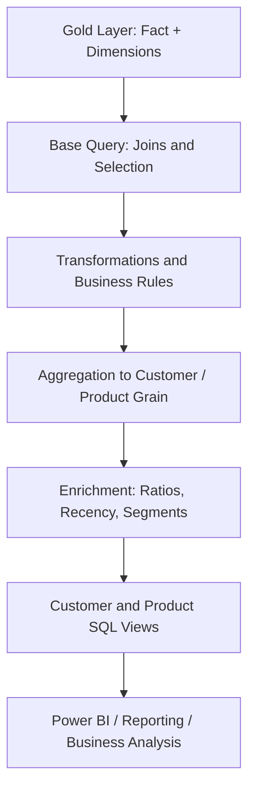

# SQL Advanced Analytics

[](https://www.microsoft.com/sql-server)
[](#project-overview)
[](#current-delivery-status)
[](https://github.com/DataWithBaraa/sql-data-analytics-project)

A SQL Server analytics portfolio project demonstrating how a dimensional data model can be explored and transformed into business-focused analysis and reusable reporting views.

The work covers exploratory data analysis, time-based analysis, cumulative metrics, performance comparisons, contribution analysis, customer/product segmentation, and reporting. It is designed to show not only how SQL statements work, but **why a particular analytical method is appropriate, what each result means, and how its correctness should be checked**.

> **Portfolio transparency:** This repository now includes a complete working set of 13 documented T-SQL scripts reconstructed from the queries and business logic discussed during development and aligned to the Gold Layer schema in the linked warehouse repository. These are organised portfolio versions, not a byte-for-byte copy of the original local scripts. They have not yet been executed in the user's SQL Server environment; the included validation script must be run and its results reviewed before claiming end-to-end verification.

## Project overview

### Business context

A business has sales transactions linked to customer and product dimensions. Decision-makers need consistent answers to questions about revenue, order activity, customer behaviour, product performance, and changes over time.

This project uses SQL to move from row-level sales data to analytical outputs that can support business review and dashboard development.

### Questions explored

- Which product categories and products contribute the most and least revenue?
- How do sales, quantities, and order activity change over time?
- How does current product performance compare with a product's historical average or previous available year?
- What percentage of total revenue is contributed by each category?
- How can products be grouped into cost bands?
- How can customers be grouped using purchasing value and activity lifespan?
- Which customer and product measures belong in reusable reporting views?

### Intended outcome

Two reporting outputs form the reporting stage:

- **Customer report:** customer-level sales, order activity, recency, lifespan, age grouping, and customer segmentation.
- **Product report:** product-level sales, quantity, order/customer counts, recency, and product performance classification.

The views are intended as a consistent SQL layer for further analysis or Power BI consumption. The precise formulas and business thresholds are documented in the scripts and validation notes.

## Analytical workflow

The project is organised into 12 topics in two stages. The reporting topic produces two separate views, so the repository contains 13 numbered SQL scripts.

### Stage 1 — Exploratory Data Analysis

| # | Topic | Script |
|---:|---|---|
| 01 | Database exploration | [01_database_exploration.sql](scripts/01_exploratory_data_analysis/01_database_exploration.sql) |
| 02 | Dimensions exploration | [02_dimensions_exploration.sql](scripts/01_exploratory_data_analysis/02_dimensions_exploration.sql) |
| 03 | Date range exploration | [03_date_range_exploration.sql](scripts/01_exploratory_data_analysis/03_date_range_exploration.sql) |
| 04 | Measures exploration | [04_measures_exploration.sql](scripts/01_exploratory_data_analysis/04_measures_exploration.sql) |
| 05 | Magnitude analysis | [05_magnitude_analysis.sql](scripts/01_exploratory_data_analysis/05_magnitude_analysis.sql) |
| 06 | Ranking analysis | [06_ranking_analysis.sql](scripts/01_exploratory_data_analysis/06_ranking_analysis.sql) |

### Stage 2 — Advanced Data Analytics

| # | Topic | Script |
|---:|---|---|
| 07 | Change-over-time analysis | [07_change_over_time_analysis.sql](scripts/02_advanced_analytics/07_change_over_time_analysis.sql) |
| 08 | Cumulative analysis | [08_cumulative_analysis.sql](scripts/02_advanced_analytics/08_cumulative_analysis.sql) |
| 09 | Performance analysis | [09_performance_analysis.sql](scripts/02_advanced_analytics/09_performance_analysis.sql) |
| 10 | Part-to-whole analysis | [10_part_to_whole_analysis.sql](scripts/02_advanced_analytics/10_part_to_whole_analysis.sql) |
| 11 | Data segmentation | [11_data_segmentation.sql](scripts/02_advanced_analytics/11_data_segmentation.sql) |
| 12 | Customer reporting | [12_report_customers.sql](scripts/03_reporting/12_report_customers.sql) |
| 13 | Product reporting | [13_report_products.sql](scripts/03_reporting/13_report_products.sql) |

The two reporting deliverables are grouped under the single Reporting topic in the 12-topic learning roadmap.

## Data model and analytical grain

The analysis consumes the Gold Layer of a separate dimensional warehouse project:

| Entity | Role | Analytical purpose |
|---|---|---|
| `gold.fact_sales` | Fact view | Sales transaction lines and measures |
| `gold.dim_customers` | Dimension view | Customer attributes used for grouping and filtering |
| `gold.dim_products` | Dimension view | Product, category, subcategory, and cost attributes |

The fact view is at **sales-line grain**: one row represents a product line within an order. Therefore, row count and order count are not interchangeable. The scripts use `COUNT(DISTINCT order_number)` when the question asks for distinct orders.

The fact view links to customers with `customer_key` and products with `product_key`. The following diagram shows the analytical flow:



See [the architecture guide](docs/architecture.md) for the detailed explanation and fact/dimension relationship diagram.

## Methods and SQL capabilities

- Joins, filtering, and relational exploration
- Aggregations and grouping with `GROUP BY`
- Common Table Expressions (CTEs) and derived tables
- Ranking with `ROW_NUMBER()` and `RANK()`
- Window aggregates with `SUM() OVER()` and `AVG() OVER()`
- Period comparisons with `LAG()`
- Date grouping and calculations with `YEAR()`, `MONTH()`, `DATEDIFF()`, and `DATEFROMPARTS()`
- Conditional classification using `CASE`
- Reusable reporting logic through SQL Server views

## Reporting design

The reporting pattern is:

1. **Base dataset:** join the fact view with the relevant dimensions and select required columns.
2. **Transformation:** derive or standardise fields using documented business rules.
3. **Aggregation:** group to the reporting grain, such as one row per customer or product.
4. **Enrichment:** calculate ratios, recency, lifespan, and classifications.
5. **Reporting view:** expose the final result through a reusable SQL Server view.

A normal SQL Server view stores a query definition; it does not automatically store a materialised copy of the result.

## Setup and execution

The analytics repository depends on the Gold Layer from the separate [SQL Data Warehouse Project](https://github.com/Ashwannii-20/SQL-Data-Warehouse-Project). It does not recreate or drop the warehouse database.

Follow [docs/setup-and-execution.md](docs/setup-and-execution.md) for prerequisites and execution order. In brief:

1. Restore or build the upstream `DataWarehouse` database.
2. Confirm the three Gold Layer views and expected columns exist.
3. Run scripts 01–11 in numerical order.
4. Run scripts 12 and 13 to create the customer and product reports.
5. Run [tests/validate_reporting_views.sql](tests/validate_reporting_views.sql) and investigate any differences.

## Repository structure

```text
sql-advanced-analytics/
├── scripts/
│   ├── 01_exploratory_data_analysis/  # Scripts 01–06
│   ├── 02_advanced_analytics/         # Scripts 07–11
│   └── 03_reporting/                 # Scripts 12–13
├── tests/
│   └── validate_reporting_views.sql
├── docs/
│   ├── architecture.md
│   ├── analytics-workflow.md
│   ├── business-rules-and-validation.md
│   ├── interview-guide.md
│   ├── setup-and-execution.md
│   └── README.md
└── README.md
```

## Quality and analytical controls

The scripts and validation guide address:

- Join cardinality and unintended row multiplication
- Reporting grain and one-row-per-entity expectations
- Reconciliation of aggregate totals to source data
- Null, zero, and missing-date handling
- Division-by-zero protection
- Date boundary behaviour and recency definitions
- Consistent segment thresholds and correctly named metrics

The report validation script includes duplicate-grain checks, source-to-report sales reconciliation, and entity-level comparisons using `EXCEPT`.

## Technology and prerequisites

- Microsoft SQL Server and T-SQL
- SQL Server Management Studio (SSMS) or an equivalent SQL editor
- Access to the upstream Gold Layer views
- Git and GitHub

The scripts use SQL Server-specific syntax. Confirm SQL Server version compatibility for date functions and view syntax before running.

## Learning reference and attribution

The learning roadmap is inspired by [Data With Baraa — SQL Data Analytics Project](https://github.com/DataWithBaraa/sql-data-analytics-project), which publishes the educational project structure, datasets, and example scripts. This repository is a separate personal portfolio workspace and is not affiliated with or endorsed by the original author. The scripts here are documented working versions written for the Gold Layer schema in the linked personal Data Warehouse repository, based on the queries and analytical rules discussed during development. The original learning reference should be acknowledged when presenting this work.

## Interview preparation

Use [docs/interview-guide.md](docs/interview-guide.md) to prepare a concise project explanation and technical walkthrough. Be ready to explain the fact grain, join logic, metric definitions, edge cases, and validation process. Do not describe the scripts as executed or validated until you have run them in SQL Server and reviewed the outputs.

## Current delivery status

| Deliverable | Status |
|---|---|
| Project overview and architecture documentation | Committed |
| 13 documented T-SQL analysis/reporting scripts | Committed; execution pending |
| Reporting validation script | Committed; execution pending |
| Interview and metric-definition guides | Committed |
| SQL Server execution and reconciliation evidence | Pending |

## Related project

[SQL Data Warehouse Project](https://github.com/Ashwannii-20/SQL-Data-Warehouse-Project) builds the Bronze/Silver/Gold data foundation. This repository focuses on consuming the Gold Layer for business analytics and reporting.