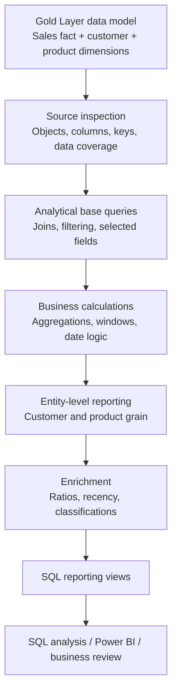
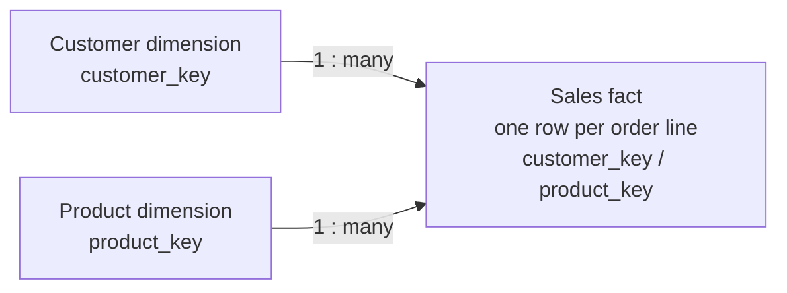

# Analytical Architecture and Data Flow

## Overview

The project consumes the Gold Layer of the related [SQL Data Warehouse Project](https://github.com/Ashwannii-20/SQL-Data-Warehouse-Project) and applies T-SQL analysis to the sales fact and its customer and product dimensions.

The workflow moves from source inspection to analytical queries and finally to reusable reporting views.

## End-to-end workflow

## Source data model

| Object | Role | Relevant content |
|---|---|---|
| gold.fact_sales | Sales fact view | Order-line measures, order date, customer and product keys |
| gold.dim_customers | Customer dimension | Customer identifiers, name, geography, profile, birthdate |
| gold.dim_products | Product dimension | Product identifiers, category, subcategory, cost, product line |

The diagrams show the intended dimensional relationships. Confirm key uniqueness and relationship cardinality in the target database before drawing conclusions from joined results.

## Fact grain and dimension coverage

The upstream Gold Layer fact view is built from sales-detail rows and uses left joins to the customer and product dimensions. Its intended grain is one row per order line.

This has two important consequences:

1. An order can occur on multiple rows, so order counts use COUNT(DISTINCT order_number).
2. If a source sales line has no matching dimension record, the corresponding dimension key can be null. The reporting views use inner joins and include only sales rows with a matching key for the relevant dimension.

The upstream product dimension contains current products only. Historical sales linked to products absent from that current dimension may not be represented in the product report. The validation script surfaces unmatched dimension keys so this coverage is visible.

## Analytical processing stages

### 1. Source inspection
Confirm database context, object definitions, columns, data types, nullability, row counts, and date coverage.

### 2. Base query
Join only the dimensions required by the business question. Select the fields needed for analysis and filter out records only when the metric definition requires it.

### 3. Transformation
Apply documented calculations and classifications. A transformation should not alter the meaning of a measure. A missing value should not be replaced with zero unless the metric definition justifies that treatment.

### 4. Aggregation
Group to the grain required by the question. Common measures include total sales, distinct orders, distinct customers, total units, and first/latest activity.

The grouping columns define the grain of the result.

### 5. Enrichment
Add derived measures such as average order value, weighted sales per unit, category contribution, month-boundary recency, calendar-month span, and classification labels. Each derived field should have a documented formula and interpretation.

### 6. Reporting views
Expose customer- and product-level query definitions through SQL Server views. A standard view stores a query definition; it does not materialise a separate copy of the result by default.

### 7. Consumption
Query the views directly or use them as a source for Power BI and other reporting tools, after validation.

## Grain and join cardinality

Grain answers: **what does one row represent?**

- Sales fact: one order line.
- Customer report: one customer with at least one qualifying dated sales record.
- Product report: one product with at least one qualifying dated sales record.

A join can multiply fact rows if the dimension key is not unique. Before aggregating, check dimension-key uniqueness and review the fact-row count and measures after joins.

## CTEs, views, and query design

A CTE names an intermediate query expression and is scoped to the single statement that follows it. It helps separate logical stages in multi-step analysis.

A view is a database object that stores a SELECT definition for reuse. A standard view improves consistency and reusability but is not the same as a materialised table.

## Validation gates

1. Confirm source objects, columns, keys, and data types.
2. Confirm dimension-key uniqueness.
3. Identify fact rows with missing customer or product mappings.
4. Confirm the intended grain before and after each join.
5. Reconcile sums and distinct counts to independent source queries.
6. Define treatment for nulls, zeros, and missing dates.
7. Protect ratio calculations from zero denominators.
8. Review date-boundary logic and business thresholds.
9. Confirm the final result has the expected columns and one row per reporting entity.
