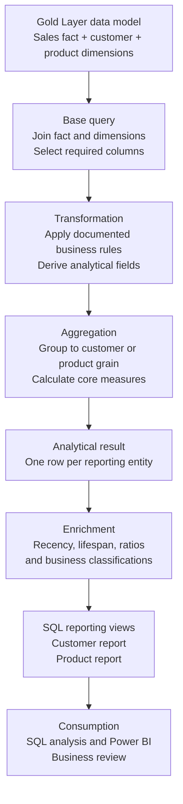

# Analytical Architecture and Data Flow

This document explains how the project turns a dimensional sales dataset into reusable analytical reports.

## End-to-end workflow

The diagram captures the analytical process: source model → base query → transformation → aggregation → analytical result → enrichment → reporting view → consumption.

## Stage-by-stage explanation

### 1. Gold Layer data model

The input is the Gold Layer dimensional model built in the separate [SQL Data Warehouse Project](https://github.com/Ashwannii-20/SQL-Data-Warehouse-Project). The sales fact contains business events and measurable values. Customer and product dimensions provide descriptive context.

Before writing analytical SQL, inspect the physical schema and confirm table names, data types, primary/surrogate keys, and join relationships.

### 2. Base query

Join the sales fact to the required dimensions and select the fields needed for the business question. Keep the base dataset focused; bringing in unused columns makes queries harder to read and maintain.

### 3. Transformation

Apply documented rules such as handling missing values, deriving date attributes, or assigning categories. A transformation must preserve the meaning of the original measure. For example, do not replace an unknown value with zero unless that treatment is justified by the business definition.

### 4. Aggregation

Group data to the level required by the question. Common measures include:

- Total sales: `SUM(sales_amount)`
- Distinct orders: `COUNT(DISTINCT order_number)`
- Distinct customers: `COUNT(DISTINCT customer_key)`
- Total units: `SUM(quantity)`
- Latest activity: `MAX(order_date)`

The grouping columns define the **grain** of the result.

### 5. Analytical result

The aggregated result should contain one row for the chosen reporting entity or group. Examples include one row per customer, one row per product, or one row per category and month.

### 6. Enrichment

Add derived measures and labels such as recency, activity lifespan, average order value, contribution percentage, customer segment, or product performance band. Each metric needs an explicit formula and a business definition.

### 7. SQL reporting views

Store the final query definitions in SQL Server views for consistent downstream use. A standard view stores its SELECT definition; it does not materialise the rows by default.

### 8. Consumption

The views can be queried directly or used as a source for Power BI and other reporting tools. The report layer should expose stable, clearly named fields with documented calculation logic.

## Grain and join cardinality

Grain answers: **what does one row represent?**

- The sales fact may be at sales-line grain. This must be confirmed from its design and keys.
- A customer report should normally contain one row per customer key.
- A product report should normally contain one row per product key.

A one-to-many or many-to-many join can multiply fact rows and inflate sums. Confirm dimension-key uniqueness and compare fact-row counts and aggregate totals before and after joins.

## CTEs, views, and query design

A CTE is a named query expression scoped to the single statement that follows it. It is useful for separating logical steps in a multi-stage query.

A view is a persisted database object that stores a query definition and can be queried by other SQL statements. It improves reuse and provides a stable interface, but a standard view is not the same as a materialised aggregate table.

## Validation gates

Before publishing a report:

1. Confirm the source object names, column definitions, and join keys.
2. Confirm the intended grain and dimension-key uniqueness.
3. Check for row multiplication after joins.
4. Reconcile sums and distinct counts with trusted source queries.
5. Define treatment for nulls, zeros, and missing dates.
6. Protect ratios from zero denominators.
7. Review date-boundary logic and business thresholds.
8. Check that each metric's name matches its formula.
9. Confirm the final output has the expected columns and entity-level uniqueness.