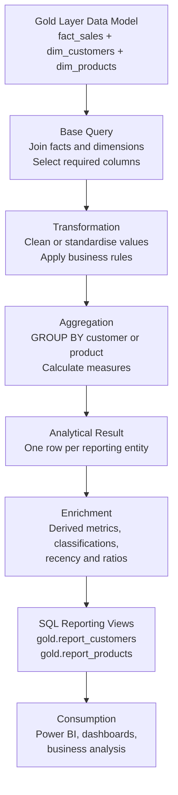

# Analytical Architecture and Data Flow

This document explains how the SQL Advanced Analytics project turns dimensional data into reusable business reports.

## 1. End-to-end flow

The diagram below recreates the analytical flow discussed during the project walkthrough. It is written in Mermaid so GitHub can render it directly and the diagram remains version-controlled alongside the documentation.

## 2. What each stage does

### 1 — Gold Layer data model

The process begins with the dimensional model:

- `gold.fact_sales` stores measurable sales events.
- `gold.dim_customers` provides customer context.
- `gold.dim_products` provides product context.

The fact table is the source of transactional measures. Dimension tables supply the descriptive attributes used to analyse those measures.

### 2 — Base query

The base query joins the fact table to the relevant dimensions and selects only the columns required for the analysis.

For example, a customer analysis may select order date, order number, sales amount, quantity, customer key, and customer attributes. A product analysis may select product key, product name, category, subcategory, cost, sales amount, and quantity.

A base query establishes a consistent row-level dataset for later calculations.

### 3 — Transformation

Transformation applies the logic needed to make the selected data suitable for analysis. Depending on the question, this can include:

- Handling missing or invalid values
- Applying date or category logic
- Creating calculated fields
- Applying explicit business definitions

Transformations must be based on documented requirements. They should not change the meaning of source measures without a clear reason.

### 4 — Aggregation

Aggregation changes the level of detail. For example, transaction-level rows can be grouped into one row per customer or one row per product.

Typical calculations include:

- `SUM(sales_amount)` for total sales
- `COUNT(DISTINCT order_number)` for distinct orders
- `COUNT(DISTINCT customer_key)` for distinct customers
- `SUM(quantity)` for total units sold
- `MAX(order_date)` for the latest order date

The `GROUP BY` columns determine the grain of the result.

### 5 — Analytical result

At this point, the query has produced the core aggregated result at the intended grain, such as one row per customer or one row per product.

This is the central result set before additional reporting attributes are added.

### 6 — Enrichment

Enrichment adds useful derived measures and labels, for example:

- Recency in months
- Customer or product lifespan
- Average order value
- Average monthly spend
- Sales contribution percentage
- Customer age group or customer segment
- Product performance category

Derived metrics should have clear definitions. For example, average sales per month and average sales per order are different measures and should not be given interchangeable names.

### 7 — SQL reporting views

The final query can be stored as a SQL Server view. A view stores the query definition, not a separate physical copy of the result by default.

The project produces:

- `gold.report_customers`
- `gold.report_products`

Views provide a consistent interface for downstream analysis and reporting.

### 8 — Consumption

The reporting views can be queried directly or connected to a reporting tool such as Power BI. This allows business users to explore consistent, prepared analytical outputs.

## 3. Important concept: grain

**Grain** means what one row represents.

- The fact table is typically at transaction or sales-line grain.
- A customer report should normally have one row per customer.
- A product report should normally have one row per product.

Always check the grain before joining or aggregating. An incorrect join can duplicate fact rows and inflate totals.

## 4. CTEs and views

A Common Table Expression (CTE) is a named query expression available to the statement that follows it. It helps break a complex query into readable logical stages.

A view is a stored database object containing a query definition. It can expose the final reporting logic for repeated use. A normal view does not automatically store a materialised copy of the query results.

## 5. Validation checklist

Before treating a report as final, verify:

1. The joins use the correct keys and do not multiply fact rows unexpectedly.
2. The row count and grain match the report's intended entity.
3. Aggregated totals reconcile to trusted source totals.
4. Nulls, zero values, and missing dates are handled deliberately.
5. Date calculations and business thresholds match their written definitions.
6. Ratios use safe division, for example `NULLIF(denominator, 0)`.
7. Derived metric names accurately describe their formulas.
8. The final view returns the expected columns and unique entity grain.
