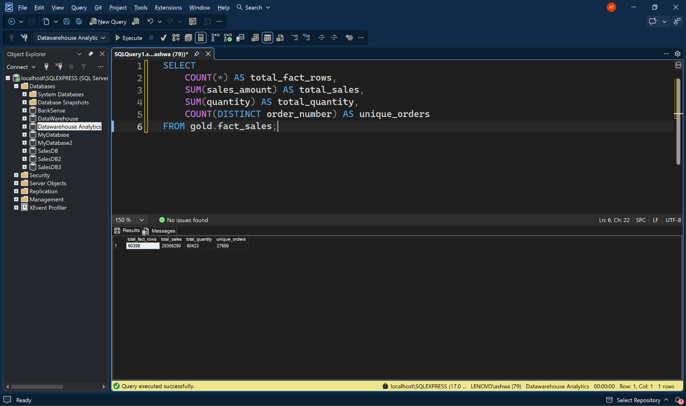
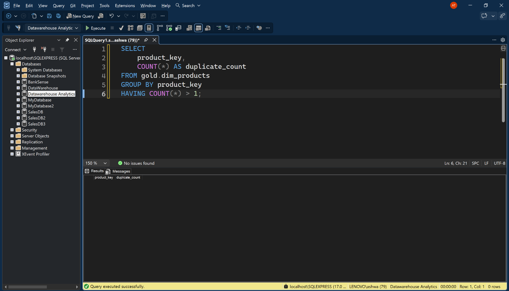
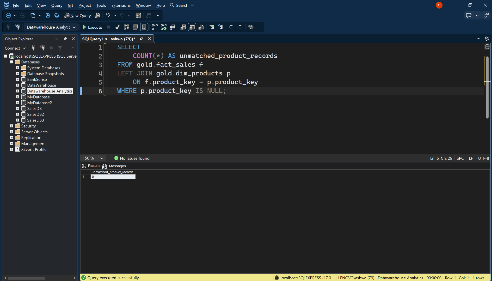
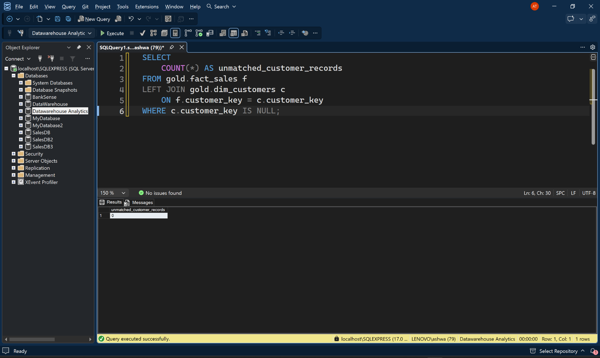
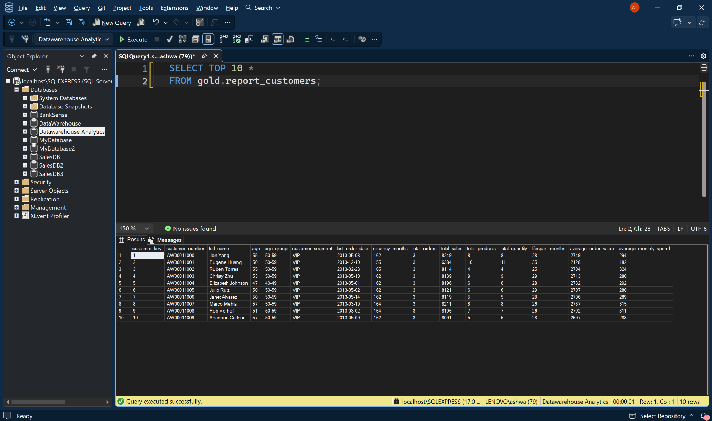
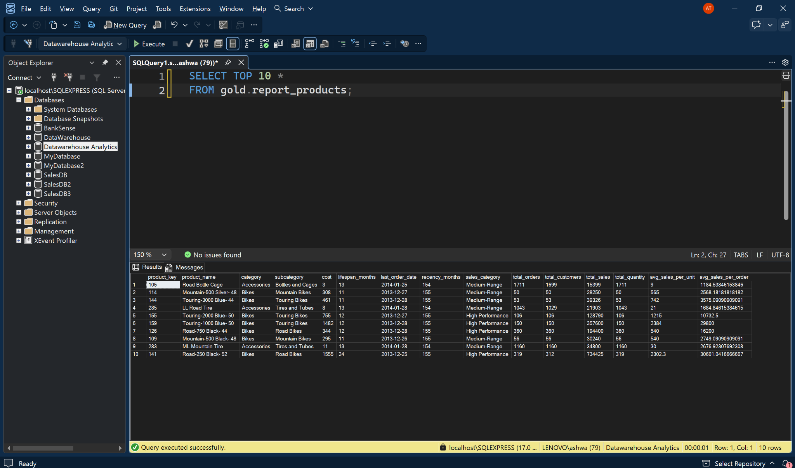
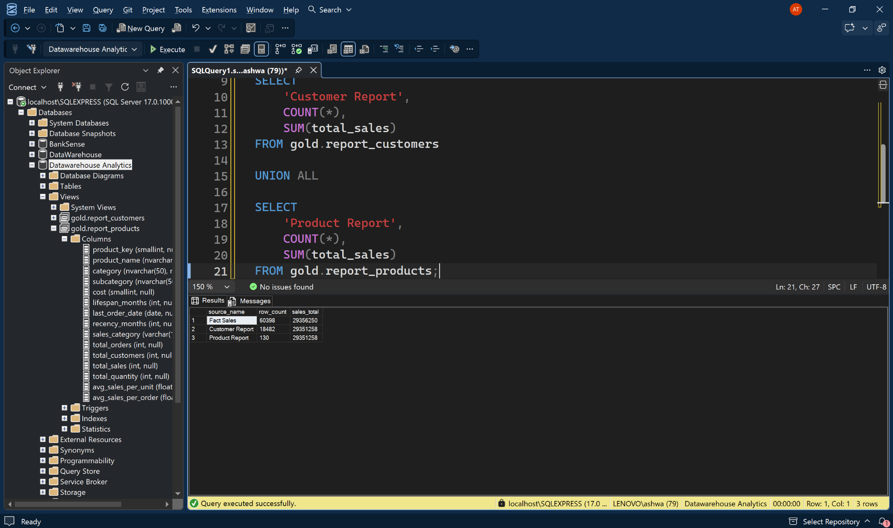
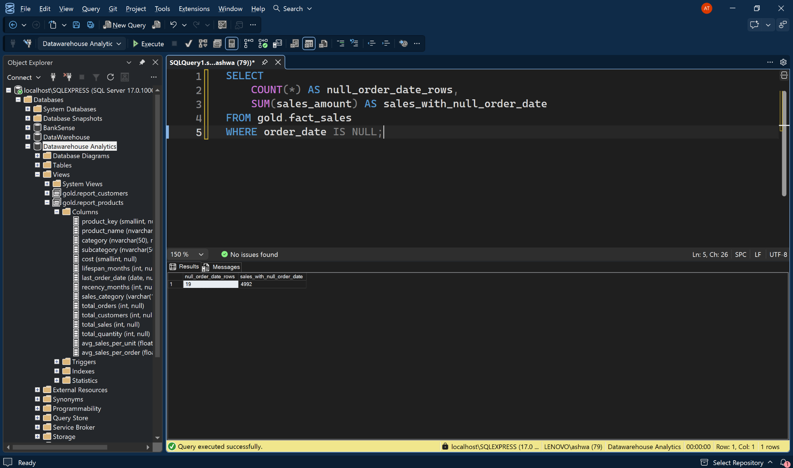

# Execution Evidence and Reconciliation

**Evidence date:** 14 November 2026  
**Client:** SQL Server Management Studio (SSMS)  
**Project:** SQL Advanced Analytics

This page records the results of the validation queries run in SSMS, with the screenshots in section 8.

## 1. Fact-table baseline

| Measure | Observed result |
|---|---:|
| Fact rows | 60,398 |
| Total sales | 29,356,250 |
| Total quantity | 60,423 |
| Distinct order numbers | 27,659 |

The fact table is at order-line grain. Therefore, the 60,398 fact rows are not the same measure as the 27,659 distinct orders.

## 2. Referential and key checks

| Check | Observed result |
|---|---:|
| Fact rows without matching customer key | 0 |
| Fact rows without matching product key | 0 |
| Duplicate product keys in product dimension | No rows returned |

## 3. Reporting-view outputs

| Report | Rows returned | Sales total |
|---|---:|---:|
| Customer report | 18,482 | 29,351,258 |
| Product report | 130 | 29,351,258 |

Both report previews returned rows successfully. The screenshots show the views `gold.report_customers` and `gold.report_products` in the SSMS Object Explorer.

## 4. Sales reconciliation

The full fact table total is 29,356,250. A separate query found 19 fact rows with a NULL `order_date`, carrying sales of 4,992.

Both reporting view definitions were checked for the `order_date IS NOT NULL` predicate, and the predicate was found in both.

| Reconciliation step | Sales |
|---|---:|
| Full fact-table sales | 29,356,250 |
| Less sales on 19 rows with NULL order date | (4,992) |
| Dated sales represented by the report filters | **29,351,258** |
| Customer report sales | 29,351,258 |
| Product report sales | 29,351,258 |
| Difference after applying the date exclusion | **0** |

The 4,992 difference is explained by the documented date filter; it is not an unexplained reconciliation variance. This calculation reconciles the date-filtered fact population to the observed report totals.

## 5. Validation scope

Checks run and shown in the screenshots:

- Fact-table baseline counts and totals.
- Successful execution of customer and product report preview queries.
- Zero unmatched customer and product keys in the tested joins.
- No duplicate product keys returned by the tested query.
- Nineteen NULL-order-date fact rows carrying 4,992 in sales.
- The date filter is present in both report view definitions.
- The report sales totals equal the dated fact sales after the NULL-date exclusion.

`tests/validate_reporting_views.sql` also covers customer-key uniqueness, one row per key in each report, entity-level `EXCEPT` comparisons and unexpected NULL or non-positive metrics.

## 6. Database

All scripts and screenshots use the `Datawarehouse Analytics` database (`USE [Datawarehouse Analytics];`).

## 7. Summary

> The sales fact contains 60,398 order lines and 27,659 distinct orders. The customer and product reporting views both total 29,351,258 in sales, compared with 29,356,250 in the full fact table. I traced the 4,992 difference to 19 rows with NULL order dates. Both reporting views intentionally filter out rows without an order date, so the dated fact total reconciles exactly to both reports. I also checked the tested customer and product joins for unmatched keys; both returned zero.

## 8. Screenshots

Original SSMS screenshots, taken 14 November 2026. Click any image to open it full size.

### 01. Fact-table baseline: 60,398 rows, 29,356,250 sales, 60,423 units, 27,659 orders

### 02. Fact rows with no matching customer key: 0

### 03. Duplicate product keys in the product dimension: no rows

### 04. Fact rows with no matching product key: 0

### 05. Product report view preview

### 06. Customer report view preview

### 07. Fact vs customer report vs product report totals

### 08. 19 rows with a NULL order date, carrying 4,992 in sales

### 09. `order_date IS NOT NULL` found in both view definitions

